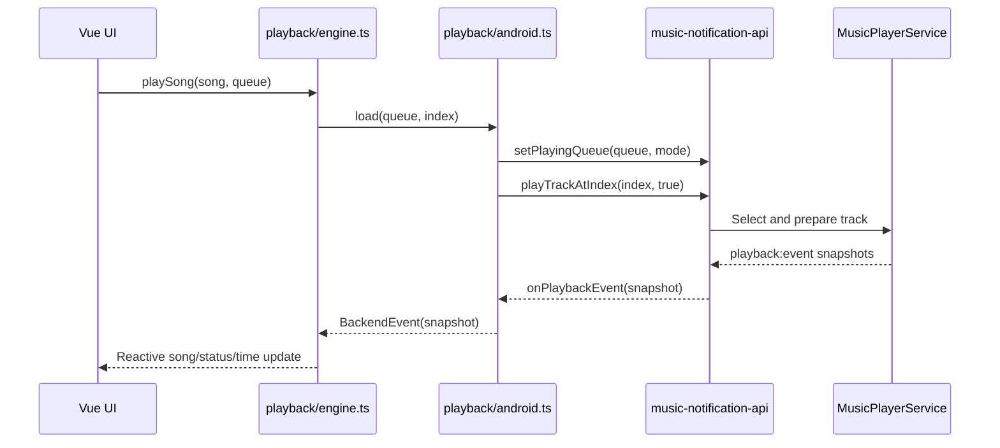

# Android Playback Session

Android playback uses the unified interface documented in
[`docs/playback-interface.md`](../playback-interface.md). The native
`MusicPlayerService` remains the transport authority while the Vue playback
engine owns queue order and user intent.

Related source files:

- `frontend/src/playback/engine.ts`
- `frontend/src/playback/android.ts`
- `frontend/src/playback/types.ts`
- `vendor/tauri-plugin-music-notification/android/src/main/java/ExamplePlugin.kt`
- `vendor/tauri-plugin-music-notification/android/src/main/java/MusicPlayerService.kt`
- `vendor/tauri-plugin-music-notification/guest-js/index.ts`

## Session Model

The plugin persists:

- the queue and current index
- the current song identity
- runtime status, position, and duration
- the native play mode

Kaulan songs are stored as stable `deviceId + songId` identities. Local files
use `localUri`, and temporary previews use `tempSongUrl`. Runtime HTTP URLs are
resolved immediately before native playback so a device address can change
without invalidating the persisted queue.

`getPlaybackSession()` is a one-shot recovery API. The frontend calls it during
initialization, after the webview becomes visible, or when an event references
a song missing from the frontend mirror. It is not polled on a timer.

## Event Flow

The service emits `playback:event` snapshots through Tauri on transitions and
every 250 ms while playing. Each snapshot contains:

- `reason`: `tick`, `transition`, or `error`
- native status: `idle`, `loading`, `playing`, `paused`, or `error`
- queue index and song ID
- position, duration, and sample time
- play mode

The Android backend converts the native snapshot to the shared
`PlaybackSnapshot` type. The engine applies it through the same path used by
the web backend. A separate frontend ticker interpolates visible position from
the latest snapshot timestamp.



## Queue and Transport Authority

The frontend engine computes next and previous indices according to the active
play mode. The Android backend calls `playTrackAtIndex` without re-sending an
unchanged queue. Native completion still advances inside
`MusicPlayerService`, because playback must continue while the webview is
backgrounded or destroyed; incoming snapshots reconcile the engine afterward.

Seeking carries an explicit `autoPlay` option. The product default is to resume
after a seek, including lyric-line and progress-bar seeks. The plugin keeps
`seekAndPlay` only for compatibility.

## Artwork Restoration

Artwork follows the playback source type:

- `kaulan`: the service derives the cover endpoint from the resolved device API
  base and song ID.
- `local_raw`: the frontend supplies the localhost
  `/api/music/id/{id}/cover` endpoint; the service also derives it when an older
  queue omits it.
- `temporary`: the provider cover URL is carried with the queue entry when
  available.

Persisted optional strings are decoded carefully. JSON `null`, blank strings,
and the legacy literal string `"null"` are treated as absent. This prevents an
invalid artwork URL from blocking the valid fallback.

The webview retries a failed cover twice because its first request can race the
localhost server during Android startup. Confirmed missing artwork then stays
on the placeholder instead of retrying forever.

## Source Resolution

Only a `content://` URI or an absolute filesystem path on localhost is sent as
`local_raw`. A restored basename is not directly openable by `MediaPlayer`, so
it remains a `kaulan` identity and streams through the backend.

Before playing a `kaulan` entry, the service requests:

```text
GET http://localhost:2080/api/discovery/resolutions/{deviceId}
```

It builds the audio and cover URLs from the returned API base. An unresolved
entry is skipped without being removed from the queue.

## Plugin API Used by the Frontend

- `onPlaybackEvent(callback)`
- `getPlaybackSession()`
- `setPlayingQueue(queue, playMode)`
- `playTrackAtIndex(index, autoPlay, startAtMs?)`
- `play()` / `pause()` / `resume()` / `stop()`
- `seek(positionMs, { autoPlay })`
- `setPlayMode(playMode)`
- `setNormalizationConfig(config)`
- `pauseAfter(delayMs)`

## Testing

`frontend/src/playback/__tests__/conformance.test.ts` runs the same playback
scenarios against the web and Android backends. Android-specific assertions
cover native auto-advance, queue reuse, session restoration, and local artwork
metadata. The plugin session tests cover persisted JSON and artwork fallback
behavior.
