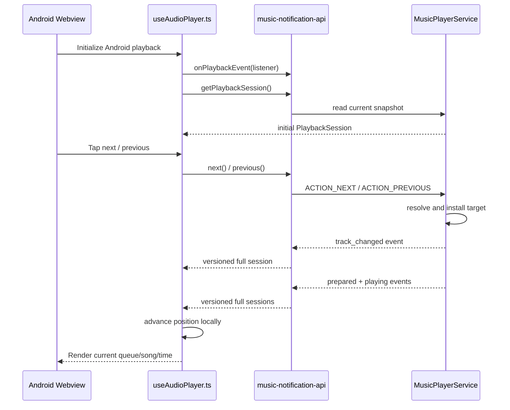

# Android Playback Session

## Overview

Kaulan uses the Android notification plugin as the playback source of truth on Android.

This document covers the Android playback/session flow implemented by:

- [`frontend/src/composables/useAudioPlayer.ts`](../../frontend/src/composables/useAudioPlayer.ts)
- [`frontend/src/App.vue`](../../frontend/src/App.vue)
- [`vendor/tauri-plugin-music-notification/android/src/main/java/ExamplePlugin.kt`](../../vendor/tauri-plugin-music-notification/android/src/main/java/ExamplePlugin.kt)
- [`vendor/tauri-plugin-music-notification/android/src/main/java/MusicPlayerService.kt`](../../vendor/tauri-plugin-music-notification/android/src/main/java/MusicPlayerService.kt)
- [`vendor/tauri-plugin-music-notification/src/models.rs`](../../vendor/tauri-plugin-music-notification/src/models.rs)
- [`vendor/tauri-plugin-music-notification/guest-js/index.ts`](../../vendor/tauri-plugin-music-notification/guest-js/index.ts)

## Why This Exists

On Android, the webview is frozen, or killed by os, so it can be recreated while the foreground playback service keeps running.

If the frontend owns the playback queue, the UI loses:

1. the current queue
2. the current playing song
3. the current playback position
4. the current play mode

To avoid that, the plugin persists a playback session and publishes semantic
playback events through Tauri's native plugin channel. The frontend reads one
snapshot during initialization or recovery; it does not query playback state on
a timer.

## Session Model

The Android plugin stores:

- `queue.songs` as stable `deviceId + songId` identities for Kaulan tracks,
  `localUri` locators for local tracks, or ephemeral `tempSongUrl` locators
- `queue.currentIndex`
- `runtime.isPlaying`
- `runtime.positionMs`
- `runtime.durationMs`
- `playMode`

The frontend receives changes through an explicit Tauri `Channel` registered by
`subscribe_playback_events`.
`getPlaybackSession()` remains available for initialization, activity resume,
and event-gap recovery.

Each event contains the complete session plus:

- `protocolVersion` for compatibility
- `serviceGeneration`, which changes when `MusicPlayerService` is recreated
- `sequence`, which detects a missed event within one service process
- `revision`, which prevents an older snapshot from overwriting newer state
- `reason`, such as `playing`, `paused`, `seeked`, or `track_changed`

The frontend app shell now consumes playback state through `frontend/src/stores/player.ts`, but that store only mirrors the runtime state. It does not replace plugin authority on Android.

## Frontend Responsibilities

The Android frontend keeps a URL-free identity shadow in localStorage for
compatibility and recovery, while the native service remains runtime authority.

Instead it:

1. copies a queue into the plugin
2. asks the plugin to play a specific queue identity
3. subscribes to native playback events
4. renders queue, song, duration, and play state from event snapshots
5. advances visible position locally from the latest native position anchor

## Playback Flow

### Start playback from a selected song

When the user taps a song in the Android webview:

1. frontend builds the queue for the active source
2. frontend computes the selected index
3. frontend calls `stop()`
4. frontend calls `setPlayingQueue(queue, playMode)`
5. frontend calls `seekAndPlay(0)`; the service resolves `deviceId` through localhost
6. service emits `track_changed`, `prepared`, and `playing` events
7. UI updates from those events

If the tap comes from the "当前播放列表" dialog, the frontend must reuse the current active queue instead of rebuilding from the playlist currently open on screen. Otherwise browsing into a different playlist can overwrite the service queue with the wrong source while the user is trying to jump within the existing playback session.

### Next and previous from the webview

The webview calls plugin-side `next()` or `previous()`. `MusicPlayerService`
owns the current index, loop behavior, queue traversal, and unreachable-device
skipping. The service emits the resulting track/session events after selecting
the target. This avoids a frontend read-modify-write race with notification,
headset, timed-pause, or native completion actions.

Normal Kaulan queue entries do not contain stream or cover URLs. Immediately
before creating each new Android media data source, `MusicPlayerService` calls
`GET http://localhost:2080/api/discovery/resolutions/{deviceId}` and builds the
runtime music and cover targets from the returned API base. A missing resolution
is skipped, and native traversal checks at most one complete queue before
stopping. Local filesystem and `content://` entries use `localUri`. Temporary
preview and direct `play({url})` entries use `tempSongUrl` only while the service
is alive and are removed from process-restart persistence.

Artwork follows the same source ownership split. The native service derives a
Kaulan entry's cover endpoint from its resolved device API base. A `local_raw`
entry still includes the localhost `GET /api/music/id/{id}/cover` URL because
its raw audio URI contains no embedded-artwork locator for the notification
service. The native service also derives that localhost URL from any positive
`local_raw` song ID when an older or incomplete frontend queue omits it.
Temporary entries carry their provider cover URL when one is available.
Artwork loading is asynchronous and does not block playback. The webview
retries a failed cover twice because its image request can race Android's
localhost server startup; confirmed missing artwork then remains on the music
placeholder instead of retrying forever.

Persisted queue JSON uses actual JSON `null` values for absent optional
locators. Session restoration checks `JSONObject.isNull` before reading those
fields; otherwise Android's `optString` turns JSON null into the literal string
`"null"`, which is neither a valid artwork URL nor a missing value. The
frontend also rejects that legacy literal when restoring sessions written by
affected builds.

### Choosing `local_raw` vs `kaulan` for a queue entry

`useAudioPlayer.ts` marks a song `local_raw` only when its `path` is a directly
openable locator — a `content://` URI or an absolute filesystem path — on a
localhost source. Songs restored from localStorage (collections, persisted
playback queue; see `frontend/src/utils/songRestore.ts`) keep only the file
basename in `path`, so they must stream as `kaulan` entries instead of handing
the native `MediaPlayer` an unopenable basename.

To let restored songs take the `local_raw` path, restore helpers first try to
adopt the song's live library entry (same source group, same `song_id`) — the
`/playlists?stream=content` response already carries each song's raw
`content://` URI. Adoption happens both when collections re-materialize
(`stores/collections.ts`, reactive over the source groups) and when a tap races
the initial load: playback entry points in `stores/player.ts` await the first
source-group settle (`libraryStore.waitForInitialSourceGroups`) and then
re-adopt the tapped song and queue via `createSongAdopter`. The basename →
`kaulan` HTTP flow remains the fallback for songs whose group is not loaded or
that no longer exist in the library, so playback never regresses to a worse
state than before adoption existed.

`kaulan` entries need a non-blank `deviceId` that the local backend can resolve
through `/api/discovery/resolutions/{id}`. Restored local songs store
`device_id: ""`, so the frontend backfills the owning source group's device id
(from `/discovery/self`) when building the native queue. When the group is
still loading (blank `device_id` before `/discovery/self` answers), the entry
keeps a `null` `deviceId` and the native side skips it until the source
resolves — a blank id is never sent.

`currentUrl` belongs to the active `MediaPlayer`, not the queue. Only the code
that installs a resolved playback target may set it, and stopping playback
clears it. In particular, `setPlayingQueue()` and session restoration never copy
a queue locator into `currentUrl`. Prepared, error, and completion callbacks
compare against the captured runtime URL, so a metadata-only queue refresh
cannot make a valid completion callback look stale. Resuming an already
prepared paused player reuses that data source without another discovery query.

## Event Transport and Recovery

The Android service is the playback authority and must keep working while the
webview is frozen or destroyed. For that reason, events are sent directly from
the Kotlin plugin to the local webview with an explicit Tauri `Channel`. A localhost
WebSocket is not used for this internal path: it would make playback-state
synchronization depend on the Rust HTTP server and require an additional socket
reconnection layer.

The event channel is intentionally ephemeral. Recovery works as follows:

1. register the event channel before requesting the initial snapshot
2. accept events in increasing `sequence` and `revision` order
3. request one snapshot when a sequence gap is detected
4. request one snapshot when the webview becomes visible after suspension
5. accept a new `serviceGeneration` as a fresh native service session

Events include the complete session, so applying an event is atomic: queue,
selected track, play mode, and runtime cannot be observed from different native
revisions.

## Playback Position Clock

Native events are not emitted every second. Each event supplies an authoritative
`positionMs` and `isPlaying` anchor. While playing, the frontend advances the
visible position with a local 250 ms rendering clock based on
`performance.now()`. Pause, seek, track, prepared, completion, and error events
replace that anchor. The rendering clock performs no plugin, HTTP, or database
query.

## LUFS Behavior

Android playback also follows the shared LUFS playback rules documented in [`docs/lufs-playback-flow.md`](../lufs-playback-flow.md).

Important note:

1. webview-initiated playback resolves current-song LUFS before playback through the frontend player
2. native auto-next inside `MusicPlayerService` also resolves current-song LUFS before playback
3. native queue/session events update visible metadata when the backend playback queue has newer LUFS values
4. volume mode and slider changes are sent once through `setNormalizationConfig()` and applied inside `MusicPlayerService`

## Sequence Diagram when tap next/prev in webview

## Lyrics on Android

No Android-specific lyric transport is needed.

Lyrics stay in the frontend:

1. native events update the current song and position anchor
2. the local frontend clock advances the playback position between events
3. the lyric composable reacts to those values

When the current song changes, the lyric request changes as well, so the lyric panel follows playback.

## Browser vs Android Seeking

- Android: seek uses the plugin `seek(positionMs)` command
- Browser/Desktop: seek uses native `HTMLAudioElement.currentTime`

The browser path intentionally uses the simplest possible behavior to avoid regressions from reload-based seeking optimizations.

## Android Plugin Commands Used

- `play`
- `pause`
- `resume`
- `stop`
- `seek`
- `set_playing_queue`
- `get_playback_session`
- `clear_playing_queue`
- `set_play_mode`
- `set_normalization_config`

## Normalization Config Flow

Android playback does not depend on repeated frontend `setVolume()` calls.

Current behavior:

1. the settings watcher in [`frontend/src/App.vue`](../../frontend/src/App.vue) reacts to volume mode and slider changes
2. [`frontend/src/composables/useAudioPlayer.ts`](../../frontend/src/composables/useAudioPlayer.ts) sends `setNormalizationConfig()`
3. [`tauri-plugin-music-notification/android/src/main/java/ExamplePlugin.kt`](../../tauri-plugin-music-notification/android/src/main/java/ExamplePlugin.kt) forwards that command to the service
4. [`tauri-plugin-music-notification/android/src/main/java/MusicPlayerService.kt`](../../tauri-plugin-music-notification/android/src/main/java/MusicPlayerService.kt) saves the config and reapplies current track volume immediately
5. later native playback operations reuse that stored config without needing the webview to resend a raw volume value every second

## ACL Requirement

The plugin command `set_normalization_config` must be present in the plugin ACL manifests and included in the plugin default permission set. Otherwise Android settings changes appear in the UI but do not affect native playback.

## Failure Handling

The Android service guards stale `MediaPlayer` callbacks during track replacement.

That prevents:

- stale `onCompletion` advancing the queue a second time
- stale `onError` interfering with the current track

Invalid source-specific queue entries are rejected at the plugin boundary.
Unresolved Kaulan identities are skipped during playback without being deleted
from the live queue. Persisted sessions retain only valid `kaulan` and
`local_raw` entries; when temporary entries are removed, the durable current
index is remapped to the same retained song.

## Related Documents

- [`docs/android/mediastore-integration.md`](./mediastore-integration.md)
- [`docs/lyrics-display.md`](../lyrics-display.md)
- [`README.md`](../../README.md)
