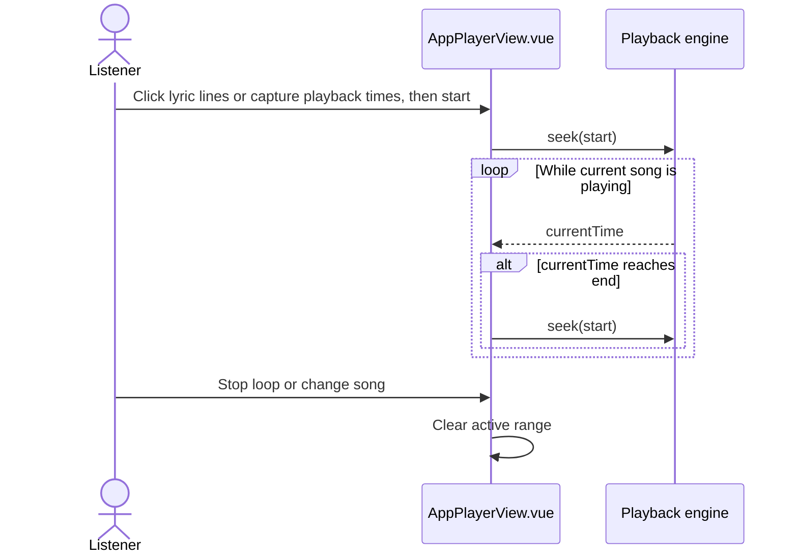

# Range Playback

The lyric panel offers **范围播放** for repeating part of the current song. It is
available in the browser and Android player. The range is temporary and clears
when the song changes. No backend API or database table is required.

## Using the UI

1. Open the lyric panel and choose **范围播放**.
2. Choose **歌词范围**, then click the first and second lyric lines of the range.
   The inclusive selection turns light green; the playing line uses bold dark
   green text. A further click starts a new selection; lines may be clicked in
   either order. Or choose **时间范围** and
   click **起点** and **终点** as playback reaches the desired positions. Either
   button can be clicked again to replace its captured time. Time range remains
   available when the song has no lyrics.
3. Choose **开始循环** once both boundaries are valid. The player seeks to the
   start and repeats the range.
   **更新范围** applies changed boundaries; **停止循环** resumes ordinary playback.
   **退出范围** closes range selection before playback starts.

Lyric clicks select lines rather than seeking while lyric range mode is active.
The lyric panel does not auto-scroll while range selection or looping is active,
so the selected passage stays in view. Auto-scroll resumes after leaving range
mode.

For lyric ranges, playback starts at the first selected line and loops when the
line after the selected last line begins. The final lyric line ends at the
track duration. The end time must be later than the start and no later than the
track duration. Seeking and pausing still use the regular player controls.

## Flow

## API and source

There is no new HTTP API. Existing `GET /api/lyrics/id/{id}` provides lyric
timestamps, `GET /api/music/id/{id}` streams audio, and the playback engine's
seek operation moves to the selected start. The UI and range boundary logic
live in `frontend/src/components/AppPlayerView.vue`; `frontend/src/App.vue`
passes the current song identity so the view can clear its active range.

For a remote development library, set `KAULAN_DEV_API_TARGET` before starting
Vite. `frontend/vite.config.ts` otherwise proxies `/api` to the local backend.
